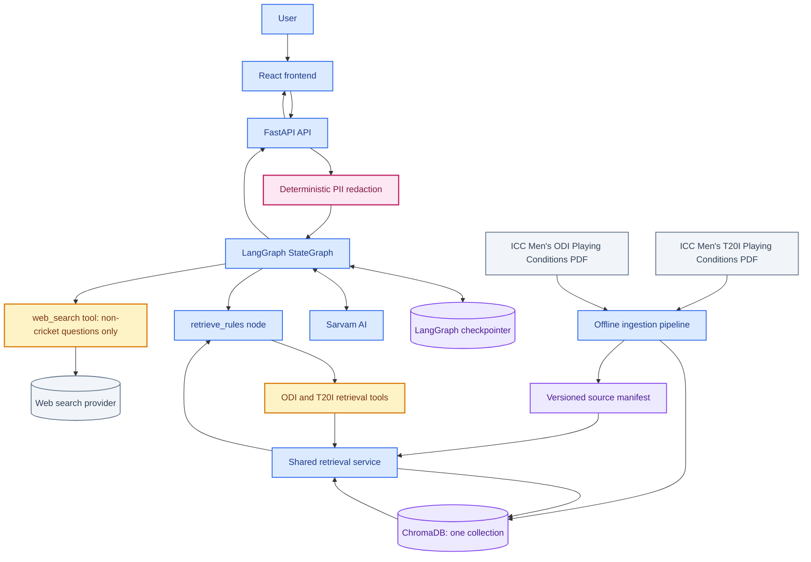
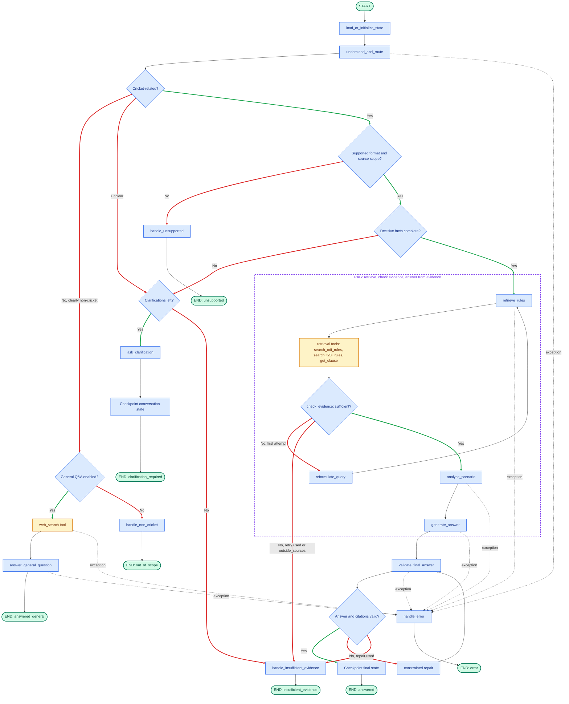
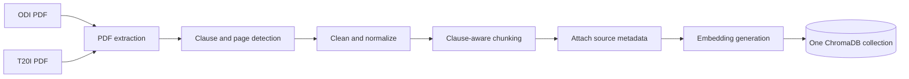

# CreaseIQ — Agent Architecture
**Version:** 1.8 | **Date:** 2 November 2026 | **Status:** Proposed V1 architecture

> A cricket-rules intelligence assistant that interprets a match scenario, retrieves the relevant ICC playing condition, explains how it may apply, and provides traceable citations. CreaseIQ is decision support, not an umpire, and cannot issue binding rulings.

## 1. V1 scope and source boundary

### Supported formats and documents

V1 uses **only these two user-provided ICC documents** (in `docs/`):

1. **ICC Men's One-Day International (ODI) Playing Conditions**, effective October 2026.
2. **ICC Men's Twenty20 International (T20I) Playing Conditions**, effective October 2026.

These documents are the canonical V1 retrieval corpus. Do not silently supplement answers with MCC documents, web sources, other ICC editions, domestic competition rules, or model knowledge.

**Laws of Cricket coverage (verify in M0).** Both documents state in their preambles that the Laws are incorporated within the Playing Conditions. Record in the manifest exactly what text the PDFs contain: if the Laws text is present, it is part of the corpus; if a question depends on a Law or provision that is not in the indexed text, abstain with the reason `outside_sources` rather than answering from memory.

### Initial release

- Formats: Men's ODI and Men's T20I.
- Response languages at launch: English and Hindi. Assamese and Kannada are deferred until language and retrieval evaluation passes.
- Competition-specific addenda: not included unless separately added, versioned, and approved as an explicit scope change. Do not imply that the generic ICC conditions cover every competition.
- **Edition and match date:** assume the supplied October 2026 edition. Always state the edition in citations and add a limitation line. Ask for a match date only when the user mentions a date or event that predates the edition, or when the answer could depend on it.
- General (non-cricket) questions: answered through a feature-flagged web-search branch, clearly labelled as not coming from the Playing Conditions (see §3). Web search is never used to answer cricket-rules questions.
- Out of scope: Test cricket, Women's formats, domestic/franchise competitions with their own conditions, live feeds, voice/image/video, DRS automation, and agentic web browsing.

**Scope statement shown to users:** "Answers are based on the ICC Men's ODI and T20I Playing Conditions (October 2026) only. Tournament-specific conditions are not included."

### Supported request types

| Intent | Handling |
|---|---|
| Scenario question | Retrieve for the resolved format, analyse, answer. |
| Named clause lookup ("what does clause X say?") | `get_clause` for the resolved format. |
| ODI vs T20I comparison | Run the search for both formats with the same query; answer side by side. |
| Clearly non-cricket question | `web_search` tool, then a general answer with source links (feature-flagged). |
| Unsure whether it is about cricket | Ask the user to rephrase. Never sent to web search. |
| Unsupported cricket (Test, Women's, competition-specific) | Explain it is unsupported. Never sent to web search. |

## 2. High-level architecture



**Request lifecycle:** React sends the message and conversation ID to FastAPI → FastAPI validates, checks conversation ownership, and redacts contact/identifier-type PII → LangGraph resumes or creates conversation state → one structured LLM call checks cricket relevance, extracts facts, resolves format and scope, and produces an English retrieval query → clearly non-cricket questions branch to a web-search general answer, unsupported requests stop before clarification → missing decisive facts trigger a clarification and a checkpoint → the single `retrieve_rules` node invokes the format-specific tool(s) → evidence sufficiency is checked, with at most one reformulated retrieval attempt → scenario analysis is generated from retrieved evidence → the user-facing answer is rendered → the final answer and citations are validated (one bounded repair) → FastAPI returns the result.

## 3. LangGraph workflow



PII redaction is not in this graph. It runs in FastAPI before the graph is entered (see §6).

Colour key: green boxes are start and end states, blue boxes are steps and decisions, yellow boxes are tools. Green arrows are yes routes, red arrows are no routes, dashed arrows are exception paths. The dashed purple box marks the RAG nodes.

### Workflow decisions

- **One routing call, model extracts and code decides.** `understand_and_route` makes one structured-output call that extracts the domain (`cricket`, `non_cricket`, `unclear`), the scenario facts, and the English retrieval query. Code then decides the intent, format, scope, missing facts and language (`decide_route`). Testing on local models showed small models are reliable at extraction but unreliable at deciding missing facts, intent and scope, so those decisions stay deterministic.
- **Three-way domain result.** `understand_and_route` returns `cricket`, `non_cricket` or `unclear`. `unclear` asks the user to rephrase and never reaches retrieval or web search. A message that merely contains a cricket word but asks an unrelated question is `non_cricket`.
- **Clarification replies use conversation history.** The routing call receives the persisted state and prior facts, so a short reply such as "ODI, 2024 World Cup" is interpreted in context, not classified alone.
- **Scope before clarification.** Unsupported formats and source scope are rejected before asking for missing scenario details.
- **Persistence is mandatory.** A LangGraph checkpointer keyed by `conversation_id` / thread ID; clarification resumes the existing state.
- **Clarifications are capped.** At most two clarification turns per question, counted in `clarification_count`. This covers both missing facts and "unclear" domain results. When the limit is reached, the graph abstains with the reason `clarification_limit` instead of asking again.
- **General Q&A switch.** A clearly non-cricket message goes to the web-search branch only when `GENERAL_QA_ENABLED` is on; otherwise `handle_non_cricket` replies politely and ends with `out_of_scope`.
- **Retrieval retry is bounded.** If evidence is weak, reformulate the English query once and retry (tracked by `retrieval_attempt`). If evidence is still insufficient, abstain. When the reason is `outside_sources`, skip the retry: a better query cannot add provisions the corpus does not contain.
- **Citations are resolved, then checked.** Models cite sloppily (a whole evidence header, a clause number instead of the chunk id, header fragments). Code maps each cited string to a retrieved passage by chunk id or clause number and drops a bare format name. Anything that matches no retrieved passage is kept as is and rejected by validation, so resolving never admits an unknown source.
- **Final validation happens after generation** and checks the actual user-facing answer. One constrained repair is allowed (tracked by `repair_attempt`), then abstain.
- **Format selection is deterministic.** The LLM never chooses between ODI and T20I tools once `format` is resolved.

### Which nodes are RAG

The RAG node is `retrieve_rules`. It calls the retrieval tools, which query ChromaDB for the ODI or T20I Playing Conditions. The diagram draws a dashed purple box around the nodes that make up the RAG part of the graph.

| Part | Nodes | Role |
|---|---|---|
| Retrieval | `retrieve_rules`, retrieval tools, `reformulate_query` | Find the right clauses in the indexed Playing Conditions. |
| Evidence control | `check_evidence` | Decide whether the retrieved text is enough; otherwise retry once, then abstain. |
| Generation from evidence | `analyse_scenario`, `generate_answer` | Reason and write using only the retrieved passages. |
| Guard (just outside the box) | `validate_final_answer` | Verify the answer and citations against the retrieved set. |

Not RAG: `understand_and_route`, `ask_clarification`, the checkpoints, and the web-search branch. Web search is a separate, unverified source and is never the knowledge base for cricket rules.

### General questions: web-search branch (feature-flagged)

When `understand_and_route` classifies a message as clearly not about cricket, the `web_search` tool runs and `answer_general_question` writes the reply, instead of a refusal. The branch is controlled by `GENERAL_QA_ENABLED`; when it is off, the same route ends with a polite `out_of_scope` refusal.

- **Only clearly non-cricket messages.** `cricket_relevance = unclear` asks the user to rephrase and never searches. Unsupported cricket questions (Test, Women's, competition-specific) stay `unsupported` and are never answered from the web, so the source boundary for cricket rules holds. A message mixing cricket and unrelated topics takes the cricket path and says the rest is out of scope.
- **Minimal query.** The provider receives only `web_query`, a short rewrite of the redacted message. Never send conversation history, checkpoint state or scenario facts.
- **Web content is untrusted.** Summarize it, never follow instructions in it, keep the tool read-only, and cap the number of results (for example 5) and the snippet length.
- **Clear labelling.** Answers return `sources` (title and URL) and the label "General answer from web search. Not based on the ICC Playing Conditions." They carry no cricket citations and not the official-ruling disclaimer. Add a caution line for medical, legal and financial topics, and apply the model's normal safety policy.
- **Privacy.** v1 does not redact names, so a non-cricket query can carry a person's name to a third-party search provider. Say so in the privacy notice.
- **Cost control.** Give this branch its own rate limit and daily cost cap, separate from cricket queries.
- **Failure behaviour.** If the search errors, route to `handle_error`; if it returns nothing useful, say no reliable sources were found. Never fill the gap from model memory.

### Node responsibilities

| Node | Responsibility |
|---|---|
| `load_or_initialize_state` | Resume state from the checkpointer or create a new thread. |
| `understand_and_route` | One structured LLM call extracts domain relevance, scenario facts, the English retrieval query and the web query. Code then decides intent, format, scope, missing facts and language. |
| `web_search` (tool) | Search the web with the short `web_query`; return a few results with titles, URLs and snippets. Non-cricket branch only. |
| `answer_general_question` | Summarize the search results into a labelled general answer with source links. If the search fails or returns nothing useful, say so; do not answer from model memory. |
| `handle_non_cricket` | When the web branch is switched off, state that CreaseIQ only handles cricket questions and do not answer. |
| `handle_unsupported` | Explain unsupported formats, source coverage, or competition-specific scope. |
| `ask_clarification` | Ask only for a missing fact that could change the rule application, or ask the user to rephrase when the domain is unclear; persist state. |
| `retrieve_rules` | One node that deterministically selects and calls the ODI/T20I tool(s) (both for a comparison). |
| `check_evidence` | Assess whether retrieved passages cover the question and its exceptions. Sets the abstention reason when not. |
| `reformulate_query` | Produce one alternative English query if the first result set is weak. |
| `analyse_scenario` | Apply retrieved rule text to the supplied facts; separate rule text from interpretation. |
| `generate_answer` | Render the analysis and citations in the requested supported language. |
| `validate_final_answer` | Deterministic citation checks plus consistency, language and disclaimer checks. |
| `handle_insufficient_evidence` | Abstain with a reason: `no_relevant_passage`, `weak_evidence`, `outside_sources`, or `clarification_limit`. |
| `handle_error` | Return a safe error; log only non-sensitive diagnostics. |

## 4. Retrieval design: one node, format-specific tools

One `retrieve_rules` LangGraph node, with no separate ODI and T20I branches. The node selects tools deterministically from the resolved `format`. These are application functions, not autonomous agents.

| Tool | Inputs | Purpose |
|---|---|---|
| `search_odi_rules` | `query`, `top_k` | Semantic search over ODI chunks only. |
| `search_t20i_rules` | `query`, `top_k` | Semantic search over T20I chunks only. |
| `get_clause` | `format`, `clause_number` | Fetch a named clause with its subclauses for that format. |
| `web_search` | `web_query` | Web search for clearly non-cricket questions only. Never used for cricket rules. Disabled when `GENERAL_QA_ENABLED` is off. |

For a comparison intent, `retrieve_rules` calls both search tools with the same query and keeps the results labelled by format. All tools call one shared retrieval implementation over **one ChromaDB collection** with a `format` metadata field; the filter is applied in code, never by the LLM.

```python
def retrieve_rules(state):
    query = state["normalized_english_query"]
    fmt = state["format"]
    if state["intent"] == "compare":
        return {"retrieved_rules": {
            "ODI": search_odi_rules(query, top_k=5),
            "T20I": search_t20i_rules(query, top_k=5)}}
    if state["intent"] == "clause_lookup":
        return {"retrieved_rules": get_clause(fmt, state["clause_number"])}
    if fmt == "ODI":
        return {"retrieved_rules": search_odi_rules(query, top_k=5)}
    if fmt == "T20I":
        return {"retrieved_rules": search_t20i_rules(query, top_k=5)}
    return {"status": "unsupported"}
```

Illustrative. Tool arguments are validated in code, tools are read-only, and every result carries source metadata. Never invent clause numbers, pages, or editions.

### Retrieval result schema

```json
{
  "passages": [{
    "chunk_id": "stable-chunk-id",
    "text": "Retrieved official rule text...",
    "source_id": "icc-odi-oct-2026",
    "source_title": "ICC Men's One-Day International Playing Conditions",
    "publisher": "ICC",
    "version": "Effective October 2026",
    "effective_from": "2026-10-01",
    "effective_to": null,
    "format": "ODI",
    "clause_number": "clause reference",
    "clause_title": "Clause title",
    "page_start": 35,
    "page_end": 36,
    "printed_page_start": 33,
    "source_url": "official source URL or supplied document reference",
    "retrieval_score": 0.0
  }]
}
```

Schema example only. Populate from the PDFs and the source manifest. Keep the exact source title and effective-date wording from each document. Store both the PDF page index and the printed page number, and show users the printed one.

## 5. Cross-lingual RAG and ingestion

The source documents are English. Questions may be English or Hindi at launch.

### Ingestion pipeline



1. Ingest only the two ICC PDFs.
2. Maintain a versioned source manifest: file checksum, exact title, format, effective date, provenance, and what the preamble says about the Laws.
3. Extract text and page information with PyMuPDF.
4. Detect headings, clauses, subclauses and page boundaries.
5. Preserve clause numbering, exceptions, tables and surrounding context.
6. Chunk by logical clause/section, not fixed-size boundaries alone.
7. Attach metadata and index chunks in one collection.
8. Verify extracted text against the PDFs, including tables and visually complex pages.

### Query flow

1. Detect the input language.
2. Keep the (redacted) original wording and the extracted cricket facts in state.
3. Produce an **English normalized retrieval query**. It may rephrase but must not add facts the user did not state, and must not contain PII placeholders.
4. Search the English corpus with the format filter.
5. If evidence is weak, create one alternative English query and retry once.
6. Return source text and provenance to the analysis node.
7. Render the response in English or Hindi without changing the rule's meaning.

Do not rely on multilingual embeddings alone. Evaluate query normalization plus embeddings against a labelled set of Hindi and English questions, and pick the embedding model on measured retrieval performance.

### ChromaDB metadata

`chunk_id`, `source_id`, `source_title`, `source_type` (so other sources can be added later without redesign), `publisher`, `version`, `effective_from`, `effective_to`, `format`, `clause_number`, `clause_title`, `subclause_number`, `page_start`, `page_end`, `printed_page_start`, `document_checksum`.

Do not add competition-scope values for competitions the corpus does not represent.

## 6. Privacy, PII handling and prompt-injection controls

### PII redaction at the API boundary

Redaction is a deterministic FastAPI preprocessing service, **not a LangGraph node and not an LLM tool**. Raw input is removed before it enters LangGraph state, Sarvam prompts, LangSmith traces, application logs or retrieval.

For v1, redact contact and identifier-type PII only: email addresses, phone numbers, personal physical addresses, account numbers and other configured identifiers.

Do **not** redact cricket scenario facts: player names, team names, venues, match names, scores, overs, cricket terminology. Avoid generic name redaction and allowlist cricket entities.

- Use typed placeholders such as `[EMAIL_1]`, `[PHONE_1]`. Apply the same preprocessing to every message, including clarification replies.
- Do not store raw messages or reversible mappings in routine logs, traces, analytics or ChromaDB. If a mapping is essential, keep it encrypted, access-controlled and short-lived; default to none.
- If redaction fails, do not forward the raw message; return a `safe_error`.
- Test both missed PII and false positives against cricket entities.
- Redaction is not a guarantee. Show a privacy notice and avoid asking for unnecessary personal details.

### Prompt-injection handling

- Treat user messages and retrieved passages as untrusted data, never as instructions that override system policy.
- Retrieved rule text is evidence only. It cannot request secrets, change tool permissions or alter the workflow.
- Keep tool permissions narrow and read-only; enforce format/source filters in code.
- The user cannot override supported-format or source-scope restrictions through prompt wording.
- Web search results are untrusted. Summarize them, never follow instructions in them, and send the provider only the short `web_query`, never history or state.

### Operational privacy

- Configure LangSmith so traces hold only redacted input and non-sensitive state.
- Disable or scrub raw request-body capture in middleware, exception reporting and access logs.
- Apply request-size limits and rate limiting at FastAPI.
- Define retention and deletion for conversation checkpoints and traces.

## 7. Structured outputs, analysis and final-answer validation

### `understand_and_route` structured output

**Extracted by the model** (validated with Pydantic): `cricket_relevance` (`cricket`, `non_cricket`, `unclear`), `scenario_facts`, `normalized_english_query`, `web_query` (non-cricket only).

**Decided in code** from the text and the extraction:
- `format`: pattern match for ODI / one-day and T20I / Twenty20 in the message and any pending question, else carried over from earlier turns.
- `intent`: `clause_lookup` if the text names a clause, `compare` if it asks for a difference or comparison, `general` if non-cricket, otherwise `scenario`.
- `unsupported_reason`: keyword checks for formats and competitions outside scope (Test, Women's, IPL and similar).
- `missing_facts`: the match format, when the intent needs it and no format is known.
- `input_language`, `response_language`: script detection, with an optional caller override.
- A message that names a format or a clause is treated as cricket even if the model said otherwise.

If the output is malformed or ambiguous, take a safe clarification or error path rather than assuming a format. Allow one automatic retry of the call on a schema failure.

### Analysis output

Keep analysis separate from prose rendering. It contains: interpreted scenario and known facts; applicable retrieved clauses; rule requirements and relevant exceptions; fact-to-rule mapping; conclusion and uncertainty; citation IDs drawn only from retrieved passages.

### Final answer validation

After `generate_answer`:
1. Every citation ID exists in the retrieved set (deterministic).
2. Every cited clause, page and source matches retrieved metadata (deterministic).
3. No new clause, quotation or source appears: extract clause references from the answer by pattern and compare them to the retrieved set (deterministic).
4. The explanation does not contradict the analysis.
5. Translation preserves the rule's meaning and qualifications.
6. Unsupported facts are not presented as established.
7. The mandatory disclaimer is present.

Checks 1–3 and 7 are code; 4–6 use an LLM check and are also measured in evaluation. If validation fails, allow one constrained repair using only the analysis and retrieved citations; if it still fails, abstain.

Every substantive answer includes: **"This is an informational interpretation of the cited playing conditions, not an official ruling by the match officials."**

## 8. Model, orchestration and service responsibilities

| Component | Technology | Responsibility |
|---|---|---|
| LLM | Sarvam AI | Structured understanding/routing, analysis and multilingual answer rendering. |
| Orchestration | Custom LangGraph `StateGraph` | Conditional routing, checkpointed conversations, bounded retries, safe termination. |
| LLM adapter | `langchain-openai` `ChatOpenAI` with custom base URL | Candidate only; verify before selecting. |
| Retrieval tools | Python functions / optional LangChain wrappers | ODI, T20I and clause-lookup interfaces. |
| Retrieval service | Shared Python module | ChromaDB filtering and provenance formatting. |
| Vector store | ChromaDB | Chunks, embeddings and metadata in one collection. |
| PDF extraction | PyMuPDF | Text and page references. |
| PII service | Deterministic library/service | Redact contact and identifier PII before graph entry. |
| Persistence | LangGraph checkpointer | State across clarification turns. |
| Tracing | LangSmith, redacted data only | Debug workflow and measure performance. |

### Sarvam compatibility checks

Verify before the design depends on it:
- Current model ID, endpoint and authentication.
- Basic completion and **structured output / JSON schema compliance**. The `understand_and_route` extraction is the riskiest model step, so test it first, in English and Hindi. A 3B local model got the domain and format right but invented missing facts, intents and unsupported reasons, which is why those are decided in code.
- Tool calling, only if the chosen graph implementation needs it (the deterministic design above does not).
- Hindi quality and preservation of cricket terminology.
- Timeouts, rate limits and error handling.

A compatible chat-completions endpoint does not guarantee structured-output or tool-calling compatibility.

## 9. Conversation state and persistence

Persistence is a **v1 requirement** because clarification is multi-turn. Use a LangGraph checkpointer with `conversation_id` as the thread ID. Store the minimum needed to resume: redacted message history; redacted original scenario wording; resolved intent, format and language; known and missing facts; clarifications already requested; match date and competition if supplied; retrieval/analysis state when needed.

When a clarification reply arrives, load the existing thread first and merge new facts into the existing scenario. Enforce conversation ownership (see the identity decision in §17). Define checkpoint retention and deletion.

## 10. Suggested LangGraph state

| Field | Purpose |
|---|---|
| `messages` | Redacted conversation history |
| `conversation_id` | Stable thread identifier |
| `question` | Current redacted user message |
| `intent` | scenario, clause_lookup, compare, general, other |
| `cricket_relevance` | cricket, non_cricket or unclear |
| `web_query` | Short query for the web-search branch |
| `input_language`, `response_language` | Input/output language |
| `format` | ODI, T20I or unknown |
| `clause_number` | For clause lookup |
| `competition`, `match_date` | Context and applicability limitation |
| `scenario_facts`, `missing_facts` | Facts accumulated across turns; facts still needed |
| `clarification_count` | Clarification turns used so far (cap: 2) |
| `normalized_english_query` | English query for retrieval |
| `retrieval_attempt` | 0 or 1 |
| `retrieved_rules` | Passages with provenance |
| `evidence_status`, `insufficient_reason` | Sufficient or not; abstention reason |
| `analysis` | Structured evidence-linked reasoning |
| `citations` | Validated source references |
| `web_sources` | Links used in a general answer |
| `answer` | Final user-facing response |
| `repair_attempt` | 0 or 1 |
| `status`, `unsupported_reason`, `error` | API result and safe error state |

Keep state minimal; add fields only when a node or API response needs them.

## 11. FastAPI contract

`POST /api/v1/chat`

Request:
```json
{
  "conversation_id": "optional-existing-id",
  "message": "The bowler has overstepped and the ball hits the stumps. What happens?",
  "response_language": "en",
  "format": "ODI",
  "competition": null,
  "match_date": null
}
```

Response:
```json
{
  "conversation_id": "conversation-id",
  "status": "answered",
  "message": "Evidence-based explanation...",
  "citations": [{
    "source_title": "ICC Men's One-Day International Playing Conditions",
    "version": "Effective October 2026",
    "clause": "verified clause reference",
    "page": 33,
    "source_id": "icc-odi-oct-2026"
  }],
  "limitations": [
    "Based on the ICC Men's ODI and T20I Playing Conditions (October 2026) only. Tournament-specific conditions are not included."
  ]
}
```

Statuses: `answered`, `clarification_required`, `unsupported`, `insufficient_evidence` (with `reason`: `no_relevant_passage`, `weak_evidence`, `outside_sources`, `clarification_limit`), `answered_general` (web-search branch, with `sources` links instead of `citations`), `out_of_scope` (non-cricket while the web branch is off), `safe_error`, `error`.

Supporting endpoints: `GET /api/v1/health`, `/api/v1/languages`, `/api/v1/formats`, optionally `/api/v1/sources`. Use Pydantic schemas and version the API. Validate conversation ownership and request limits at the API boundary. The languages and formats endpoints are plain backend functions, not graph tools.

## 12. Frontend boundary

**React owns:** chat UI, conversation history, language and format controls, clarification input, citations, limitations (including the scope statement), loading and error states.

**React must not:** call Sarvam directly, connect to ChromaDB, implement rule reasoning or retrieval, choose which source governs, or bypass FastAPI privacy controls. All communication goes through FastAPI.

## 13. Technology inventory

| Layer | Technology | Status |
|---|---|---|
| Frontend | React | Selected |
| Backend API | FastAPI | Selected |
| API schemas | Pydantic | Selected / proposed |
| Orchestration | LangGraph `StateGraph` | Selected |
| LLM | Sarvam AI | Selected; structured output and Hindi quality to verify |
| LLM adapter | `langchain-openai` `ChatOpenAI` | Candidate; compatibility unverified |
| Retrieval tools | Python functions: ODI, T20I, clause lookup | Selected design |
| Vector database | ChromaDB, one collection | Selected |
| PDF processing | PyMuPDF | Proposed |
| Embeddings | To be selected by evaluation | Open decision |
| Persistence | LangGraph checkpointer | Required for v1 |
| Web search provider | To be selected | Open decision; needed only for the general-question branch |
| PII detection | Deterministic library/service | Required |
| Tracing | LangSmith with redaction before graph entry | Existing / proposed |
| Tests | Pytest | Selected |
| API tests | FastAPI TestClient / HTTPX | Proposed |
| Containers | Docker | Selected |
| Reverse proxy | Existing Traefik or Nginx | Reuse existing setup |
| Hosting | VPS | Existing deployment target |
| Logging | Structured logging without raw PII | Required |
| Evaluation | Versioned multilingual cricket scenario set | Required |

**Not in V1:** MCC document ingestion, extra formats, competition addenda, multi-agent frameworks, agentic web browsing, live match feeds, voice/image/video, DRS automation.

## 14. Tests and release quality gates

Build an initial evaluation set of **at least 100 scenarios**, version-controlled, including:
- ODI and T20I scenarios with expected clauses and answer points.
- Hindi and English versions of representative scenarios.
- Ambiguous scenarios requiring clarification, short clarification replies that depend on history, and users who keep giving unclear answers until the clarification cap is hit.
- Unsupported formats and competition-specific questions.
- Similar questions whose ODI and T20I provisions differ, and comparison and clause-lookup requests.
- Retrieval failures, insufficient evidence, and abstention cases including `outside_sources`.
- Domain tests: indirect cricket questions, cricket words in non-cricket contexts, mixed-topic messages, uncertain cases.
- Web branch tests: non-cricket questions reach `web_search`; cricket and unsupported-cricket questions never do; prompt injection inside search results is ignored; answers carry source links and the "not from the Playing Conditions" label.
- Prompt-injection attempts in user messages and in retrieved text.
- PII detection and false-positive cases, especially player, team and venue names.

Measure: domain precision/recall, format accuracy, clarification correctness, retrieval recall@k and correct-format rate, citation precision and validity, answer correctness, translation fidelity, abstention quality, and latency, token usage, cost and error rates.

Release gates:
- No raw PII enters Sarvam, LangGraph state, LangSmith traces, routine logs or ChromaDB.
- Redaction failure stops processing; an `unclear` domain result never reaches retrieval or web search.
- Web search runs only for `non_cricket` messages, only with the short `web_query`, and only when `GENERAL_QA_ENABLED` is on.
- Clarification reliably resumes prior state; unsupported scope is checked before clarification.
- Every returned passage's `format` equals the requested format.
- At most one retrieval retry, one answer repair and two clarification turns occur.
- No fabricated or out-of-set citations; the final answer passes validation.
- Every answer carries the non-official-ruling disclaimer.
- English and Hindi quality meet agreed thresholds. Assamese and Kannada stay disabled until separately evaluated.

## 15. Suggested repository structure

```text
creaseiq/
├── backend/
│   ├── app/
│   │   ├── main.py
│   │   ├── api/{routes_chat.py,middleware.py}
│   │   ├── schemas/
│   │   ├── agent/{graph.py,state.py,nodes.py,routing.py,prompts.py}
│   │   ├── tools/cricket_rules.py
│   │   ├── privacy/pii_redaction.py
│   │   ├── rag/{ingest.py,chunking.py,retrieval.py,vector_store.py}
│   │   ├── services/{sarvam.py,source_manifest.py}
│   │   └── config.py
│   ├── tests/
│   └── requirements.txt
├── docs/                     # the two ICC Playing Conditions PDFs
├── data/{manifest/,evaluation/}
├── frontend/
├── docker-compose.yml
├── .env.example
└── README.md
```

## 16. Build sequence

| Milestone | Deliverable |
|---|---|
| M0 — Sources and setup | Confirm the two October 2026 PDFs, record checksums and metadata, record what the preambles say about the Laws, document licensing constraints, set up repo and environment. |
| M1 — Core workflow | Verify Sarvam structured output and Hindi; API-boundary PII redaction; checkpointer; `understand_and_route`; scope-before-clarification routing; custom StateGraph with mock retrieval. |
| M2 — Two-document RAG | Ingest the PDFs, build one collection with format metadata, implement the retrieval tools and English-normalized retrieval. |
| M3 — Answer reliability | Evidence check, one query retry, structured analysis, final answer validation, citation integrity, disclaimer, abstention. General-question web branch behind a feature flag. |
| M4 — Evaluation | Build 100+ scenarios; evaluate English and Hindi, retrieval, citations, clarification, privacy. Enable more languages only after they pass their own evaluation. |
| M5 — API/UI | Complete the FastAPI contract, React integration, conversation ownership, citations and limitations. |
| M6 — Deployment | Docker, VPS, reverse proxy, rate limiting, structured logs, LangSmith redaction, health checks. |

**Learning approach:** first build a small `create_agent` tool-calling exercise with one mock cricket-rule tool. Then implement the production workflow with a custom `StateGraph`. Build incrementally; do not generate the whole application in one pass.

## 17. Decisions and remaining open items

Resolved:
- [x] Corpus limited to the two ICC documents.
- [x] One `retrieve_rules` node with format-specific tools; one ChromaDB collection with a `format` filter.
- [x] PII redaction at the FastAPI boundary, before graph entry and tracing.
- [x] Domain classification merged into `understand_and_route`, failing closed when uncertain.
- [x] Scope checks precede clarification.
- [x] Persistence via LangGraph checkpointer is mandatory.
- [x] English normalized query for retrieval; one retry; one answer repair.
- [x] Final answer and citation IDs are validated.
- [x] Launch languages are English and Hindi.
- [x] Competition addenda are outside the initial scope.
- [x] Comparison and clause lookup are supported intents.
- [x] Clearly non-cricket questions get a labelled web-search answer, behind a feature flag; cricket questions never use web search.

Still open:
- [ ] Select and evaluate the embedding model.
- [ ] Verify the Sarvam model ID, endpoint, structured-output compatibility and Hindi quality.
- [ ] Confirm what the PDFs contain about the Laws, and how cleanly PyMuPDF extracts clause numbering and tables.
- [ ] Decide user identity for conversation ownership (login, signed session token, or anonymous cookie).
- [ ] Select the production checkpointer backend and the retention policy for checkpoints and logs.
- [ ] Confirm licensing for storing, indexing and quoting the ICC documents.
- [ ] Select the web search provider, and confirm its terms of use, cost and data handling for the general-question branch.
- [ ] Define evaluation thresholds for release.
- [ ] Tune `top_k`, similarity threshold and chunk size against the evaluation set.
- [ ] Decide whether hybrid retrieval or reranking is justified by baseline results.

## 18. Change log

| Version | Date | Changes |
|---|---|---|
| 1.0 | 2026-11-02 | Initial V1 architecture and tool inventory. |
| 1.1 | 2026-11-02 | Restricted sources to the two ICC Playing Conditions PDFs. |
| 1.3 | 2026-11-02 | Revision adding checkpointer, scope-before-clarification, English query normalization, one retry, post-generation validation, English/Hindi launch, prompt-injection controls, and API-boundary PII redaction. |
| 1.4 | 2026-11-02 | Merged v1.1 and v1.3 into this single file. Bounded the repair loop; restored the fail-closed domain rule and the `outside_sources` abstention reason; restored clause lookup and comparison as supported intents; relaxed match-date clarification; added printed page numbers, deterministic clause-reference check, and the user-identity open item. |
| 1.5 | 2026-11-02 | Added a feature-flagged web-search branch for clearly non-cricket questions (`web_search` tool, `answer_general_question`, `answered_general` status, guardrails); three-way domain result; consistent workflow colours (green start/end, blue steps, yellow tools) with green yes and red no arrows; RAG nodes marked with a dashed box and explained in §3. |
| 1.6 | 2026-11-02 | Applied remaining graph fixes: clarification cap (`clarification_count`, `clarification_limit` abstention) covering missing facts and unclear domain results; explicit `GENERAL_QA_ENABLED` decision with a `handle_non_cricket` refusal path; web-search failure behaviour; diagram arrow colours re-indexed. |
| 1.7 | 2026-11-02 | `understand_and_route` now splits work: the model extracts domain, facts and the English query; code decides intent, format, scope, missing facts and language. Based on a run of the workflow notebook against a local 3B model, which was unreliable at those decisions. |
| 1.8 | 2026-11-02 | Three fixes from the first real-model run: no retrieval retry when the reason is `outside_sources`; citations are resolved to retrieved passages (by chunk id or clause number) before validation; test failure hooks no longer depend on model wording. |
